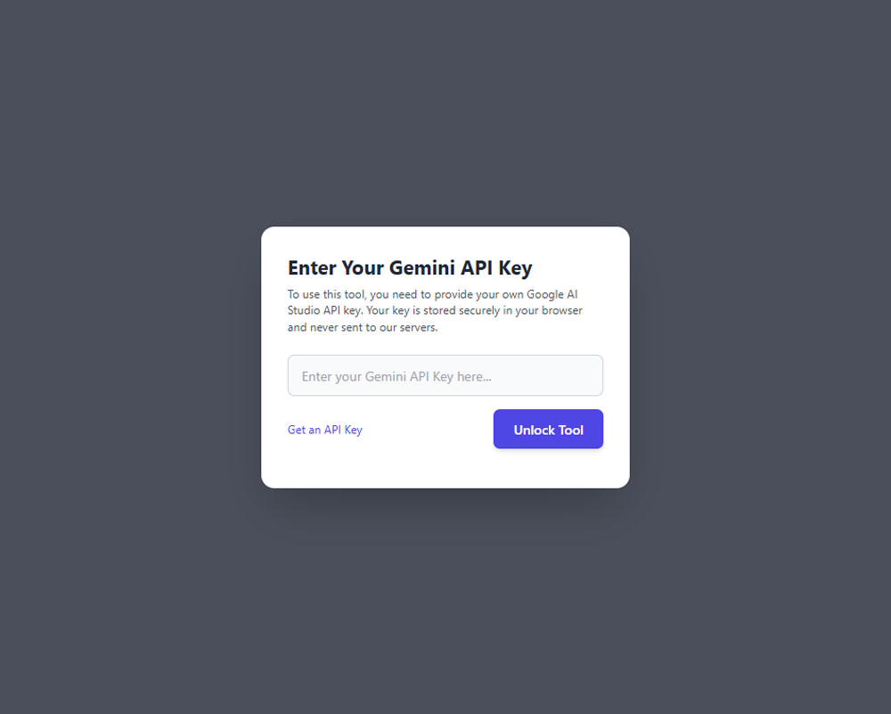
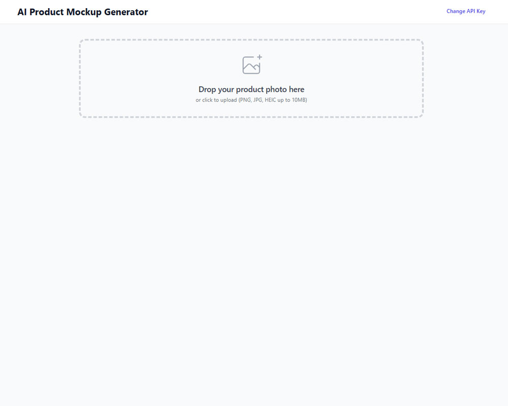
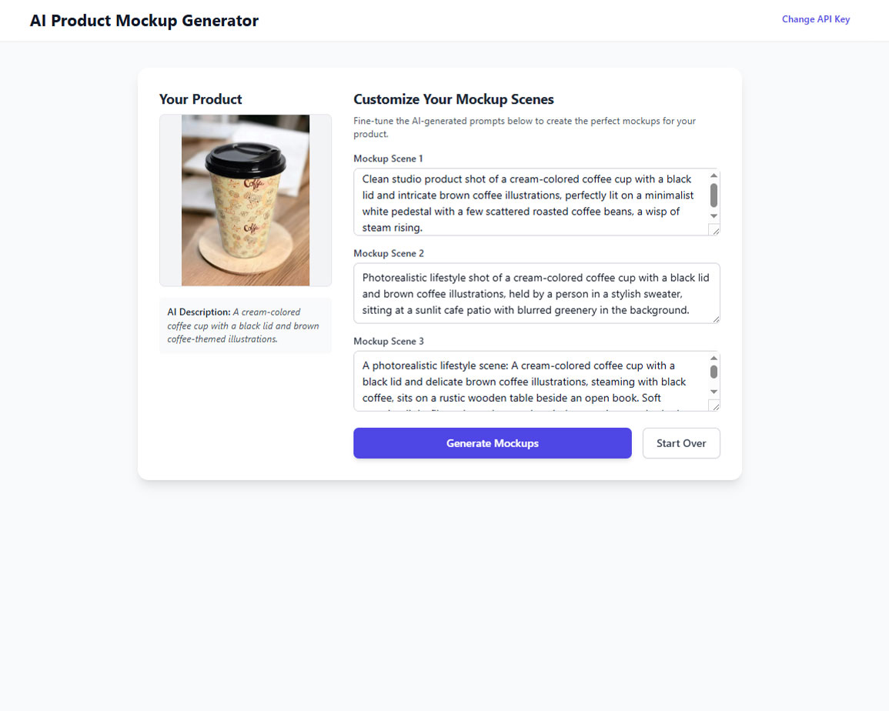
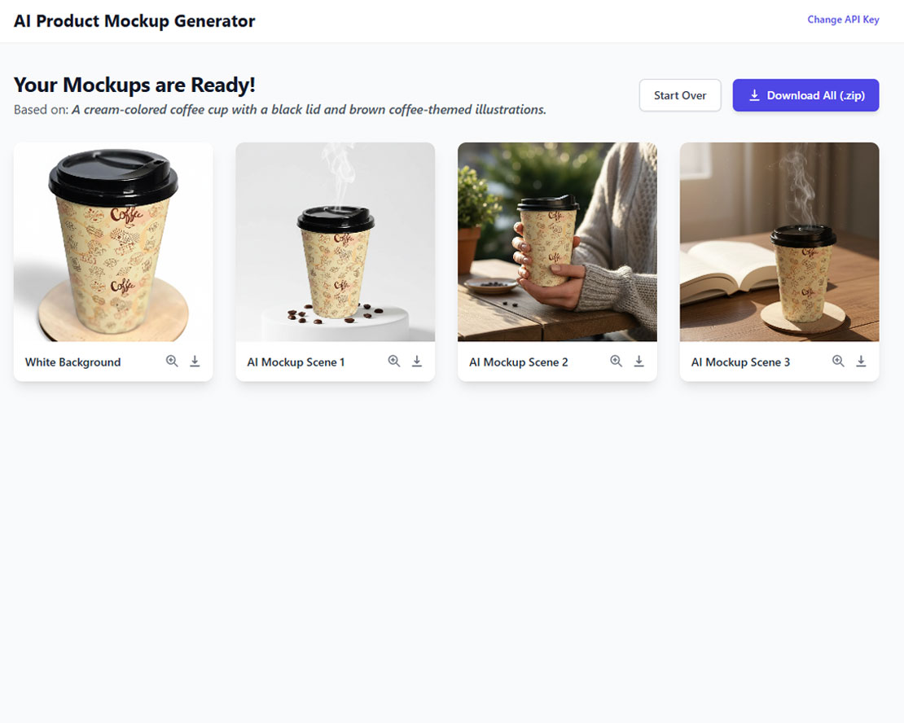

# 🎨 AI Product Mockup Generator

A modern, AI-powered product mockup generation tool built with **React**, **TypeScript**, and **Tailwind CSS**. Upload your product photos and automatically generate professional mockups with AI-generated scenes using Google's Gemini API.

**Key Features:** Automatic product description generation, customizable mockup scenes, white background removal, and batch download functionality.

---

## 📸 Screenshots






---

## ✨ Features

- 🤖 **AI-Powered Analysis** - Automatic product description using Gemini Vision
- 🎭 **Smart Mockup Generation** - AI-generated contextual scene prompts
- 🎨 **Multiple Output Formats** - White background + 3 custom mockup scenes
- ✏️ **Editable Prompts** - Fine-tune AI-generated scene descriptions
- 📦 **Batch Download** - Download all mockups as a ZIP file
- 🔍 **Image Lightbox** - Full-screen preview with zoom functionality
- 📱 **Responsive Design** - Mobile-first, fully responsive UI
- 🔐 **Secure API Key Storage** - Browser-based storage, never sent to servers
- 🎯 **Drag & Drop Upload** - Intuitive file upload experience

---

## 🚀 Getting Started

### Prerequisites

- **Node.js** (>=18)
- **Google AI Studio API Key** - [Get your free API key](https://aistudio.google.com/app/apikey)
- Modern web browser

### Installation

1. **Clone the repository:**

```bash
git clone https://github.com/matrixprompter/AI-Product-Mockup-Generator.git
cd AI-Product-Mockup-Generator
```

2. **Install dependencies:**

```bash
npm install
```

3. **Start the development server:**

```bash
npm run dev
```

4. **Open your browser:**

Navigate to [http://localhost:3000](http://localhost:3000)

5. **Enter your Gemini API Key:**

On first launch, you'll be prompted to enter your Google AI Studio API key.

---

## 📂 Project Structure

```
.
├── src/
│   ├── components/
│   │   ├── ApiKeyModal.tsx      # API key input modal
│   │   ├── common/
│   │   │   └── Spinner.tsx      # Loading spinner component
│   ├── context/
│   │   └── ApiKeyContext.tsx    # API key state management
│   ├── services/
│   │   └── geminiService.ts     # Gemini API integration
│   ├── types/
│   │   └── index.ts             # TypeScript type definitions
│   ├── App.tsx                  # Main application component
│   └── index.tsx                # Application entry point
├── public/                      # Static assets
└── package.json
```

---

## 🛠 Tech Stack

- **React 18** - Frontend framework
- **TypeScript** - Type-safe development
- **Tailwind CSS** - Utility-first styling
- **Google Gemini API** - AI vision and image generation
- **React Dropzone** - File upload handling
- **JSZip** - Batch file compression
- **Vite** - Fast build tool and dev server

---

## 🎯 How It Works

1. **Upload Product Image** - Drag & drop or click to upload (PNG, JPG, HEIC up to 10MB)
2. **AI Analysis** - Gemini AI analyzes your product and generates a description
3. **Scene Generation** - AI creates 3 contextual mockup scene prompts
4. **Customize** - Edit the generated prompts to match your vision
5. **Generate** - AI creates 4 high-quality mockups:
   - Clean white background version
   - 3 custom scene mockups
6. **Download** - Preview, download individually, or get all as ZIP

---

## 🔑 API Key Setup

### Getting Your Gemini API Key

1. Visit [Google AI Studio](https://aistudio.google.com/app/apikey)
2. Sign in with your Google account
3. Click "Get API Key" or "Create API Key"
4. Copy your API key
5. Enter it in the application modal

### API Key Storage

- Stored securely in browser's local storage
- Never transmitted to any servers (except Google's API)
- Can be changed anytime via "Change API Key" button

---

## 📸 Supported Image Formats

- **PNG** (.png)
- **JPEG** (.jpg, .jpeg)
- **HEIC** (.heic)
- **Max file size:** 10MB

---

## 🌍 Deployment

### Deploy with Vercel

```bash
npm install -g vercel
vercel deploy
```

### Deploy with Netlify

```bash
npm run build
# Upload the 'dist' folder to Netlify
```

### Environment Variables

No environment variables needed! The app uses client-side API key storage for security.

---

## 🎨 Customization

### Styling

All styles use Tailwind CSS utility classes. Customize the theme in `tailwind.config.js`:

```js
module.exports = {
  theme: {
    extend: {
      colors: {
        primary: '#4F46E5', // Indigo
        // Add your custom colors
      }
    }
  }
}
```

### AI Prompts

Modify the prompt generation logic in `src/services/geminiService.ts`:

```typescript
export async function generateMockupPrompts(apiKey: string, description: string): Promise<string[]> {
  // Customize your prompt engineering here
}
```

---

## ⚠️ Limitations & Best Practices

- **API Costs:** Gemini API usage may incur costs after free tier
- **Image Quality:** Higher resolution input = better output quality
- **Rate Limits:** Be mindful of API rate limits
- **Best Results:** Use clear, well-lit product photos with minimal background clutter

---

## 🐛 Troubleshooting

### "API Key Invalid" Error
- Verify your API key at [Google AI Studio](https://aistudio.google.com/app/apikey)
- Ensure the key has access to Gemini models

### Image Upload Fails
- Check file size (<10MB)
- Verify file format (PNG, JPG, HEIC)
- Try a different browser

### Generation Takes Too Long
- Large images take longer to process
- Check your internet connection
- Verify API quota availability

---

## 📜 License

This project is licensed under the **MIT License**.

---

## 🙌 Acknowledgments

- [Google Gemini AI](https://ai.google.dev/) - AI image generation and vision
- [Tailwind CSS](https://tailwindcss.com/) - UI styling
- [React Dropzone](https://react-dropzone.js.org/) - File upload
- [Heroicons](https://heroicons.com/) - Icon library

---

## 🤝 Contributing

Contributions, issues, and feature requests are welcome! Feel free to check the [issues page](https://github.com/matrixprompter/AI-Product-Mockup-Generator/issues).

### Development Guidelines

1. Fork the repository
2. Create your feature branch (`git checkout -b feature/AmazingFeature`)
3. Commit your changes (`git commit -m 'Add some AmazingFeature'`)
4. Push to the branch (`git push origin feature/AmazingFeature`)
5. Open a Pull Request

---

## 🗺️ Roadmap

- [ ] Multiple product batch processing
- [ ] Custom background color options
- [ ] More mockup scene templates
- [ ] Image history and favorites
- [ ] Export to different file formats
- [ ] Advanced editing tools
- [ ] Preset mockup styles

---

## 💡 Use Cases

- **E-commerce** - Create professional product listings
- **Marketing** - Generate social media content
- **Product Design** - Visualize products in different contexts
- **Presentations** - Professional product showcases
- **Portfolio** - Display products in realistic scenarios

---

## 📧 Contact

For questions, feedback, or collaboration opportunities:
- 🌐 Website: [matrixprompter.com](https://matrixprompter.com/contact/)
- 🔗 All Links: [linktr.ee/matrixprompter](https://linktr.ee/matrixprompter)
- 📂 Other Projects: [matrixprompter/repositories](https://github.com/matrixprompter?tab=repositories)

---

Made with ❤️ by [matrixprompter](https://github.com/matrixprompter)